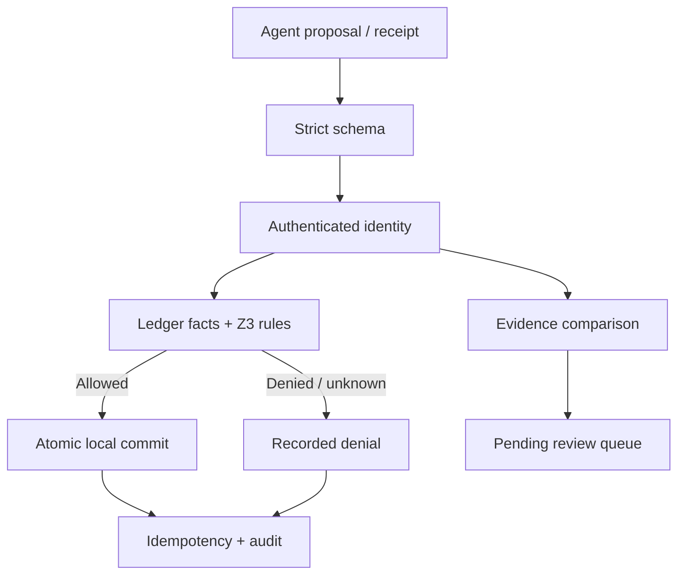

# CommerceGuard

An executable reliability laboratory for AI-assisted digital commerce: strict proposals, ledger-grounded Z3 decisions, atomic synthetic refunds, recoverable MCP reads, and receipt review.

Built for a portfolio demonstration of applied AI engineering in commerce. Independent project; no Sony affiliation, PlayStation APIs, customer data, or official refund rules. All policies and records are synthetic.

**Start with [the Windows VS Code guide](docs/VS_CODE_GUIDE.md).** Python 3.12 is the reference environment. No Docker, WSL, GPU, or API key is required for the offline path.

```powershell
py -3.12 -m venv .venv
.\.venv\Scripts\python.exe -m pip install -c constraints-tested.txt -e ".[dev,gemini]"
.\.venv\Scripts\python.exe -m pytest -q
.\.venv\Scripts\python.exe -m commerceguard demo
.\.venv\Scripts\python.exe -m commerceguard evaluate
```

## What is implemented

| Component | Behavior |
|---|---|
| Strict proposal contract | Integer cents, positive bounded amounts, USD, extra fields rejected; no agent-supplied account eligibility |
| Trusted facts | Authenticated principal's ledger record supplies ownership, purchase date, consumption, and remaining balance |
| Policy engine | Z3 constraints, named unsat cores, all violated constraints, policy hash, fail-closed unknown result |
| Safe execution | Check, balance update, refund entry, idempotency result, and audit event in one SQLite transaction |
| Duplicate protection | Same owner/key/body returns stored result; changed body with same key returns conflict |
| Explanation | Counterfactual maximum describes a possible new request; never changes the original request |
| HTTP API | Bearer-protected ledger, refund, receipt triage, review queue, audit verification; Swagger at `/docs` |
| MCP | Actual SDK stdio transport exposing ledger lookup, refund request, receipt triage |
| Read recovery | Bounded transient retries, durable trace states, process-local circuit breaker, identity-preserving schema adapter |
| Multimodal adapter | Optional Gemini image extraction into validated receipt fields; not a receipt-authenticity detector |
| Review queue | Durable owner-scoped pending items; no automatic approval or reviewer override endpoint |
| Audit / policy replay | Hash-chain consistency check; historical snapshot comparison under a proposed cap |
| Evaluation | Synthetic fixtures, independent arithmetic oracle, fault injection, race/replay tests, real MCP client/server test |
| Delivery | Windows instructions, VS Code launch configuration, tested dependency constraints, GitHub Actions matrix |

## Trust boundaries



Model-generated text, receipt contents, and extracted facts are untrusted. Only the application supplies the identity. Receipt matching does not trigger the money path. Local process/database administrators remain trusted.

## Synthetic policy

Maximum $150 per action; $200 per account per UTC day; no refund above remaining paid value; purchase age 0–14 days; unconsumed purchase; USD only. Purchase age differs from account age. Tier rules from the source sketch are intentionally replaced with explicit ledger-based policy. These are design examples, not Sony policy or legal compliance rules.

An `unsat_core` is one inconsistent subset, not necessarily every violation. `violations` lists all failed concrete checks. Z3 proves satisfaction of the encoded constraints for supplied facts; it does not prove those facts are truthful or the whole system is secure. Simple arithmetic is sufficient for this small policy; the independent oracle tests that equivalence. Z3 offers a path to more complex policy interactions, not demonstrated speed superiority.

## Results and limits

See [verification evidence](docs/VERIFICATION.md) and the reproducible JSON in `docs/results/`. Latency over tiny mixed valid/invalid fixtures is not a throughput claim. The schema-only baseline is deliberately weak and is not a comparison against commercial systems.

Atomicity covers this local database only. A remote payment provider needs an outbox, provider-side idempotency, and reconciliation of unknown outcomes. The audit chain detects ordinary edits but cannot stop a database administrator rewriting the chain or truncating its tail; externally anchor signed heads before claiming tamper resistance. The circuit breaker is process-local and resets on restart. Read recovery expects the operation itself to enforce I/O timeouts; it cannot interrupt a hung arbitrary callable. The API uses a single configured principal/token for a local demo, not multi-user production identity infrastructure.

Gemini calls are optional and were not run against a live account during package preparation. No paid service, actual refund, or public deployment is part of the offline demo.

## Where to extend

Read [the exceptional-project roadmap](docs/ROADMAP.md), [threat model](docs/THREAT_MODEL.md), and [design decisions](docs/DESIGN.md). Prioritize measured improvements on independent workloads over claims of unprecedented novelty.

## Official implementation references

- MCP Python SDK: https://github.com/modelcontextprotocol/python-sdk
- Google GenAI Python SDK: https://github.com/googleapis/python-genai
- Gemini structured output: https://ai.google.dev/gemini-api/docs/structured-output
- Z3: https://github.com/Z3Prover/z3
- FastAPI: https://fastapi.tiangolo.com/
