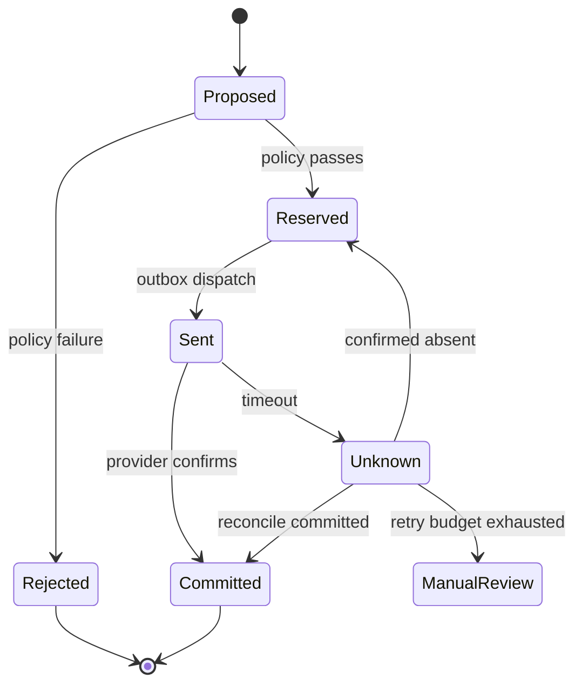

# Make CommerceGuard exceptional through evidence

The valuable research question is: **Can an agent commerce gateway maintain authorization and monetary invariants across uncertain model output, retries, crashes, concurrency, and policy changes while keeping useful automation high?**

No claim that this system is unprecedented has been established. Its strongest current distinction is joining trusted facts, transactional enforcement, audit explanations, and executable failure scenarios in one reproducible demonstration.

## Delivered foundation

- Atomic decision/execution inside one ledger transaction.
- Durable idempotency across restarts and conflicting-payload detection.
- Ledger ownership checks outside model control.
- Solver explanations and advisory counterfactual limits.
- Real MCP tools with transient read recovery and durable state traces.
- Model extraction separated from receipt authenticity and payment authorization.
- Review queue, audit-chain consistency checks, read-only policy replay.
- Adversarial fixtures, property testing, race tests, rollback injection, and CI configuration.

## Build order and measurable acceptance gates

| Phase | Work | Acceptance evidence |
|---|---|---|
| 1: Reproduce, 1–2 days | Run Windows guide, push private repo, execute CI matrix, record 3-minute demo | Your terminal results, all CI jobs green, versioned report |
| 2: Independent evaluation, 1 week | Author 300+ labeled cases across ownership, amount, currency, time, replay, consumption, receipt mismatch; reserve a held-out set before tuning | Dataset card, train/dev/test separation, useful approval rate and unsafe-commit rate with confidence intervals |
| 3: Live agent boundary, 1 week | Compare a Gemini agent with schema-only, deterministic-only, and full gateway variants; use identical tasks, seeds where supported, policy, and transaction simulator | Model IDs, prompt hashes, usage/cost, proposal fidelity, false rejection, human-review load, per-stage latency; report failures |
| 4: External payment simulator, 1–2 weeks | Implement a separate provider process supporting idempotency, deliberate timeout-after-commit, duplicate callbacks, and outages; add transactional outbox + reconciler | Kill/restart both services during workloads; no duplicate debit and all unknown outcomes reconcile or escalate |
| 5: Policy change safety, 1 week | Versioned policy registry, policy approval workflow, historical replay plus sequential alternate-history simulation; test concurrent rollout | Counterexample traces for bad policy, invariant tests, rollback procedure |
| 6: Operational hardening, 1–2 weeks | PostgreSQL migrations, multi-principal OIDC/RBAC, reviewer separation, bounded request bodies/rate limits, OpenTelemetry, external audit-head anchoring | Multi-tenant isolation tests, load profile, restore drill, replayed audit evidence |
| 7: External validation | Have another engineer author attacks and reproduce your release; write a technical report | Independently reproduced findings, documented limits, comparisons to credible baselines |

Timelines are planning estimates. Do phases sequentially rather than claiming all are complete at release v0.1.0.

## The most promising next experiment

Simulate an external refund that **commits at the provider but times out before the agent sees the response**. A naive retry risks duplicate money movement. Use a stable operation ID, provider query/reconciliation, and a persistent state machine:

This remote-execution state machine is a planned extension, not present in v0.1.0. Do not call the local SQLite implementation "exactly once payments." The business effect can be made idempotent under explicit provider assumptions; arbitrary external systems do not inherit SQLite's atomicity.

## Benchmark design

Keep the deterministic enforcement benchmark separate from the model's ability to understand a request. Include a simple arithmetic engine because this initial policy does not need Z3 for correctness. Do not hide a weaker baseline behind vague "unprotected AI" claims.

Measure: unsafe monetary effects, legitimate task completion, proposal fidelity, false denials, repeated-effect count, recovery time, unresolved state count, human-review rate, cost per completed task, and p50/p95/p99 latency under a stated workload. Separate malformed requests that fail quickly from valid requests that invoke a solver/database. Zero observed failures is not proof of zero risk; publish sample sizes and bounds.

For receipts, create synthetic clean, blurred, cropped, altered-amount, duplicate-ID, and embedded-instruction images. Label extraction correctness separately from authenticity (which images alone may not establish). Never interpret the model's self-reported confidence as calibrated probability. Calibrate a measured classifier on held-out examples if confidence routing is introduced.

## Honest portfolio description after reproducing the release

"Built a Python commerce-agent reliability prototype integrating Z3 policy checks, authenticated ledger access, transactional refunds, persistent idempotency, MCP tools, and receipt review. Verified rollback, concurrent requests, replay, and account isolation through automated synthetic tests."

Replace test counts and evaluation claims with your own recorded results. Do not claim Sony deployment, production traffic, guaranteed compliance, zero financial leakage, or a hiring guarantee.
